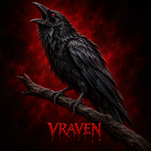
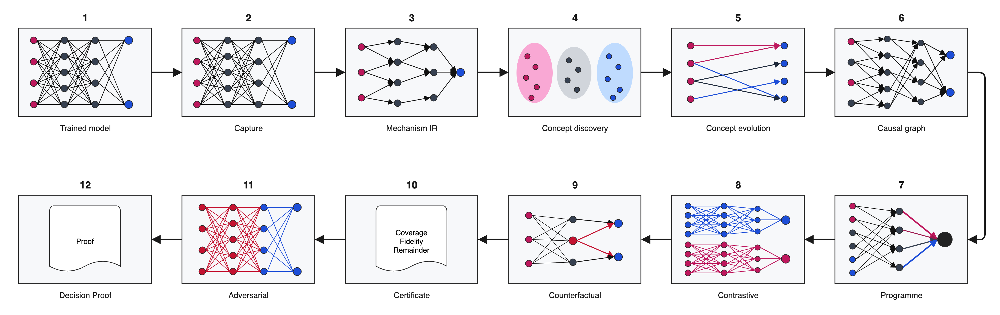

# VRAVEN

<p align="center">
  
</p>

<p align="center">
  <strong>Evidence-aware explainability and causal model auditing for PyTorch</strong><br>
  Trace internal representations, test candidate mechanisms and publish reproducible, auditable reports.
</p>

<p align="center">
  <a href="https://pypi.org/project/vraven/"></a>
  <a href="https://pypi.org/project/vraven/"></a>
  <a href="https://github.com/vraven-ai/vraven/blob/main/LICENSE"></a>
</p>

<p align="center">
  <a href="https://vraven-ai.github.io/vraven/"><strong>Documentation</strong></a> ·
  <a href="https://vraven-ai.github.io/vraven/guides/getting-started.html">Quick start</a> ·
  <a href="https://vraven-ai.github.io/vraven/api/">Python API</a> ·
  <a href="https://pypi.org/project/vraven/">PyPI</a> ·
  <a href="https://github.com/vraven-ai/vraven/issues">Issues</a>
</p>

VRAVEN stands for **Visual Reasoning and Activation Visualisation for
Explainable Networks**. It is an explainability and model-auditing toolkit for
researchers and practitioners investigating how a trained neural network reaches
a decision—not merely which input features correlate with its output.

VRAVEN can capture internal evidence, inspect candidate concepts, test selected
relationships through interventions, search for bounded counterfactuals and
report what the analysis did—and did not—cover. It keeps observational evidence
separate from causal evidence and does not present an attractive visualisation
as proof by itself.

> **Built on published research in neural-network explanation since 2010.**
> VRAVEN brings together selected ideas from published work on local decision
> explanation, attribution, concept testing, faithfulness evaluation, causal
> abstraction, mechanistic interpretability and programme extraction. This
> research informed VRAVEN's development; the original methods remain the work
> of their respective authors. VRAVEN's contribution is the integration of
> compatible ideas into a reproducible, testable model-auditing workflow.

## Why researchers choose VRAVEN

- **Evidence levels are explicit:** Observational, interventional, empirical and
  formal results are labelled rather than blended into one confidence claim.
- **One model supports many research questions:** Inspect single predictions,
  cohorts, adversarial behaviour, counterfactuals, checkpoints and matched models.
- **Results are reproducible:** Reports retain configuration, model and target
  context, evidence coverage, limitations and machine-readable outputs.
- **Methods are inspectable and extensible:** The Python API, Mechanism IR and
  focused analysis components support new experiments without hiding the protocol.
- **Models and traces remain local:** VRAVEN adds no telemetry or remote upload.

## Install

VRAVEN requires Python 3.10 or newer. Use a clean virtual environment so the
package and its PyTorch dependencies do not affect other projects.

```bash
python3 -m venv .venv
source .venv/bin/activate
python -m pip install --upgrade pip
python -m pip install vraven
vraven doctor
```

On Windows PowerShell, activate the environment with
`.venv\Scripts\Activate.ps1`. If installation reports that the release requires
a newer Python version, run `python --version` and install Python 3.10 or newer.

## Create your first report

Run the deterministic demonstration to create one self-contained HTML report:

```bash
vraven demo --mode gradient \
  --report-format html \
  --output vraven-demo.html
```

Open `vraven-demo.html` in a browser. The report contains the prediction,
evidence visualisations, analysis metadata and stated limitations.

## Analyse your own model

For a saved state dictionary, provide the Python factory that rebuilds the
model and a representative input tensor:

```bash
vraven analyse model.pt \
  --model-format state_dict \
  --model-factory my_project.models:Classifier \
  --input input.pt \
  --task explain \
  --preset standard \
  --format html \
  --output vraven-report.html
```

If the model has several files or configuration values, place them in a VRAVEN
model bundle. The
[model-folder guide](https://vraven-ai.github.io/vraven/guides/model-folder.html)
walks through the required files, validation and analysis commands.

> A `model.pt` file does not always contain the model architecture. A saved
> `state_dict` also needs the model class or factory that created it. Full
> Python-pickled models should only be loaded when their source is trusted.

## Python API

```python
import vraven

report = vraven.explain(model, inputs, target=1, mode="causal")
report.write_report("vraven-report.html")
```

Change the output extension to write one supported report per call, such as
`vraven-report.pdf` or `vraven-trace.json`. See the
[API reference](https://vraven-ai.github.io/vraven/api/) for the complete
signatures and return types.

## What VRAVEN can do

- ✅ Explain an individual prediction in fast, gradient or causal mode
- ✅ Capture PyTorch computation in an architecture-neutral Mechanism IR
- ✅ Discover and track candidate internal concepts across layers
- ✅ Compile and measure targeted internal interventions
- ✅ Recover and test compact executable decision programmes
- ✅ Produce contrastive and bounded counterfactual evidence
- ✅ Run adversarial, stability, LRP and supported formal analyses
- ✅ Analyse datasets, compare models and follow checkpoint evolution
- ✅ Export one HTML, PDF or JSON report per invocation
- ✅ Record evidence coverage, limitations and unresolved computation

Run `vraven features` for the capability inventory installed on your machine.
Use the
[command guide](https://vraven-ai.github.io/vraven/guides/commands.html) to pick
one focused workflow and see its parameters.

## How the analysis fits together

VRAVEN connects model capture, internal concept discovery, intervention,
programme recovery, counterfactual testing and evidence certification in one
traceable workflow.

<p align="center">
  
</p>

The workflow is not a claim that every analysis completes every stage. Reports
identify unsupported operations, missing evidence and the scope within which a
result was produced.

## Choose the right starting point

| Goal | Start here |
| --- | --- |
| Install VRAVEN and create a first report | [Getting started](https://vraven-ai.github.io/vraven/guides/getting-started.html) |
| Analyse a model and its configuration files | [Model folders](https://vraven-ai.github.io/vraven/guides/model-folder.html) |
| Select a terminal workflow | [Command guide](https://vraven-ai.github.io/vraven/guides/commands.html) |
| Use VRAVEN from Python | [API reference](https://vraven-ai.github.io/vraven/api/) |
| Choose a report format and understand its evidence | [Report guide](https://vraven-ai.github.io/vraven/guides/reports.html) |
| Review the scientific foundations | [Research foundations](https://vraven-ai.github.io/vraven/research.html) |

## Scientific boundaries

VRAVEN does not claim that every model can be fully captured, that every
discovered direction has human meaning, or that a recovered programme is
globally unique. Internal counterfactual validity is also distinct from
real-world domain validity. Treat each result according to its stated evidence
level, coverage and assumptions.

## Privacy and security

Analysis runs locally by default and VRAVEN adds no telemetry. Full
Python-pickled models are blocked unless trusted loading is explicitly enabled.
Never load a pickle from an untrusted source.

## Contributing

Research contributions are welcome, including new model-compatibility tests,
reproducible case studies, numerical validation, scientific visualisations,
documentation and carefully scoped analysis methods.

Start with the [contribution guide](https://github.com/vraven-ai/vraven/blob/main/CONTRIBUTING.md), run the existing test suite, and
open an [issue](https://github.com/vraven-ai/vraven/issues) before a large API or
methodological change. New scientific metrics must state their mathematical
definition, assumptions, interpretation, limitations and validation plan.

## Project status

VRAVEN is experimental research software. APIs, report schemas and supported
operations may change before a stable 1.0 release. Contributions and reproducible
bug reports are welcome; see the [contribution guide](https://github.com/vraven-ai/vraven/blob/main/CONTRIBUTING.md).

Licensed under Apache-2.0. See the [licence](https://github.com/vraven-ai/vraven/blob/main/LICENSE) and [notice](https://github.com/vraven-ai/vraven/blob/main/NOTICE).

## Citation

If VRAVEN supports your research, cite the exact software version used. GitHub's
**Cite this repository** control reads [CITATION.cff](https://github.com/vraven-ai/vraven/blob/main/CITATION.cff), or use:

```bibtex
@software{jeremiah2026vraven,
  author  = {Daniel Jeremiah},
  title   = {VRAVEN: Visual Reasoning and Activation Visualisation for Explainable Networks},
  year    = {2026},
  version = {0.10.1},
  url     = {https://github.com/vraven-ai/vraven},
  license = {Apache-2.0}
}
```
